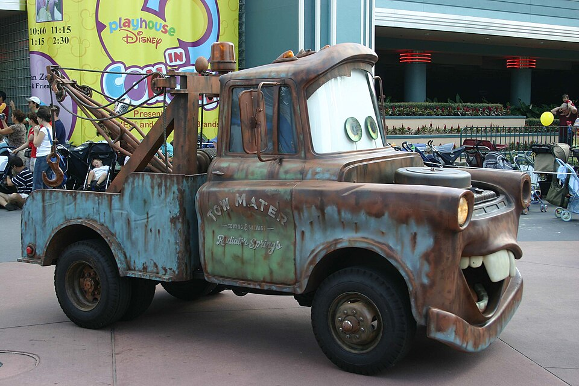

# Roncs Autó

Android segédapp elhagyott, roncs jármű bejelentéséhez. A rendszámot kamerával vagy saját fotóról olvassa (CameraX + ML Kit). A JSZP-t és a Járókelőt nem helyettesíti: mindkettőt a felhasználó nyitja meg, és a bejelentést is ő küldi el.

Matuka (angolul Tow Mater) a Disney•Pixar *Verdák* (*Cars*, 2006) vontatója. A karakter a Disney•Pixar tulajdona; ez a projekt nem állítja, hogy a figura vagy a fénykép joga hozzá tartozik.

A fenti kép Edward Russell fotója: „Tow Mater”, 2006. október 9., Stars and Motor Cars felvonulás, Disney-MGM Studios. [Creative Commons Attribution 2.0](https://creativecommons.org/licenses/by/2.0/). Forrás: [Wikimedia Commons](https://commons.wikimedia.org/wiki/File:Tow_Mater_(265156851).jpg). A README-be a Commons 960 px széles változata került, vágás nélkül.

Az indítóikon ugyanebből a fotóból készült: az arc (szem és fogsor) a négyzet közepére került, az adaptív ikon 66 dp-es biztonságos körén belül, hogy a kör alakú maszk ne vágja le. A kép szélén a fotó elhomályosított részlete látszik. Ez a vágás és átméretezés a CC BY 2.0 szerinti módosítás.

## Mit csinál

- Élő kamerával keres magyar rendszámot.
- Saját fotót is meg lehet nyitni (a rendszer fotóválasztója, tárolási engedély nélkül). A képet lekicsinyíti, a forgatást figyelembe veszi, és azon is rendszámot keres.
- A rendszámot a vágólapra teszi, és megnyitja a JSZP oldalát. Belépni és lekérdezni a felhasználónak kell.
- A műszaki lejáratot kézzel lehet megadni: beillesztett JSZP-szövegből, vagy egy képernyőkép felismeréséből. A dátumot meg kell erősíteni. Csak akkor kerül a bejelentés szövegébe, ha a mai napnál korábbi.
- Járókelő: a szöveget vágólapra másolja, a fotót megosztani vagy elmenteni lehet, és megnyitja a bejelentő űrlapot. A fotót az űrlapon kézzel kell kiválasztani.

## Amit nem csinál

- Nem lép be a JSZP-be, nem kezel jelszót, és nem kérdez le járműadatot. A rendszámból nem talál ki lejárati dátumot.
- Nem küld bejelentést a Járókelőre, és nem tölti fel a fotót a nevében.
- A böngésző fájlválasztóját nem tudja kitölteni: az Android nem írhat bele egy weboldal fájlmezőjébe.

## Használat

1. Nyisd meg a projektet Android Studio-ban, vagy telepítsd a debug APK-t.
2. A kamera engedélye kell az élő képhez. Elutasítás után a saját fotó ettől még használható.
3. Irányítsd a kamerát a rendszámra, vagy nyomd meg a **Saját fotó** gombot.
4. **Lekérdezés a JSZP-n:** a rendszám a vágólapon van. Ügyfélkapu+ vagy DÁP belépés után te kéred le az adatot.
5. **Műszaki dátum megadása:** illeszd be a JSZP szövegét, vagy válassz egy képernyőképet. Ellenőrizd a felismert dátumot, és csak utána erősítsd meg. Ha a szövegben más rendszám van, a dátum nem kerül át. Ha nincs benne rendszám, külön meg kell erősíteni, hogy ehhez a járműhöz tartozik.
6. **Bejelentés a Járókelőn:**
   - a leírás a vágólapon van, illeszd a *Probléma leírása* mezőbe;
   - ha van fotó, oszd meg vagy mentsd el, majd a *Képek* mezőben válaszd ki ugyanazt;
   - a bejelentkezést és az elküldést a Járókelőn kell megtenni.

A mai napon vagy később lejáró műszaki nem kerül be „lejártként”. A megadott dátum törlődik, ha másik rendszámot olvas az app.

## JSZP

A hivatalos belépési pont: [magyarorszag.hu/jszp_szuf](https://magyarorszag.hu/jszp_szuf). A szolgáltatás leírása: [nyilvantarto.hu – Jármű Szolgáltatási Platform](https://nyilvantarto.hu/jarmuszolgaltatasiplatform/). Rendszám alapján, a Központi Azonosítási Ügynökön (Ügyfélkapu / DÁP) keresztüli belépés után érhető el, köztük a műszaki érvényesség. Nyilvános, azonosítás nélküli lekérdező API-t ezek az oldalak nem adnak. Az app ezért nem hív rejtett végpontot, nem kaparja az oldalt, és nem automatizálja a belépést. A dátum csak a felhasználó által beillesztett szövegből vagy az általa kiválasztott képernyőképből származhat, megerősítés után. Ez nem JSZP-lekérdezés.

## Járókelő

A bejelentés menete a [Járókelő leírása](https://jarokelo.hu/problema-bejelentese/hogyan-mukodik) szerint: címet, leírást, kategóriát, helyszínt és egy vagy több fotót a felhasználó ad meg a webes űrlapon. A 2026-os oldal a `/problema-bejelentese` címet a [`/bejelentest-teszek`](https://jarokelo.hu/bejelentest-teszek) űrlapra viszi. Az űrlap a leírást és a képeket belépés után, multipart űrlapmezőkben küldi a Járókelő saját API-jára. A jelenlegi felület nem olvas `description` query paramétert (a v1.0.0 ilyen URL-t nyitott; ez nem előtöltés). Web Share Target manifestet vagy dokumentált, harmadik félnek szánt fotós share API-t nem találtam. A 2025-ös API-bejelentés a saját mobilalkalmazásukra és önkormányzati rendszerekre vonatkozik, nem erre az appra. Ezért nincs automatikus feltöltés és nincs rejtett POST. A szöveg a vágólapon, a fotó megosztással vagy a felhasználó által választott helyre mentve adható át.

## Rendszám

A felismerés a szokásos magyar formákat kezeli: `ABC-123` (1990–2022), `AB CD-123` (2022. július 1-jétől; az első betűpár két magánhangzó vagy két mássalhangzó, a CS, GY, LY, NY, SZ, TY, ZS nélkül, kivéve az `OT` sorozatot), valamint a régi `GT-12-34`. Nem következtet O/0 vagy I/1 cserére.

## Fejlesztés

```text
./gradlew testDebugUnitTest assembleDebug
```

A `v1.0.0` git címke az első commiton marad. Ez a változat az alkalmazásban 1.1.0 (versionCode 2); külön GitHub-release nem készül.
